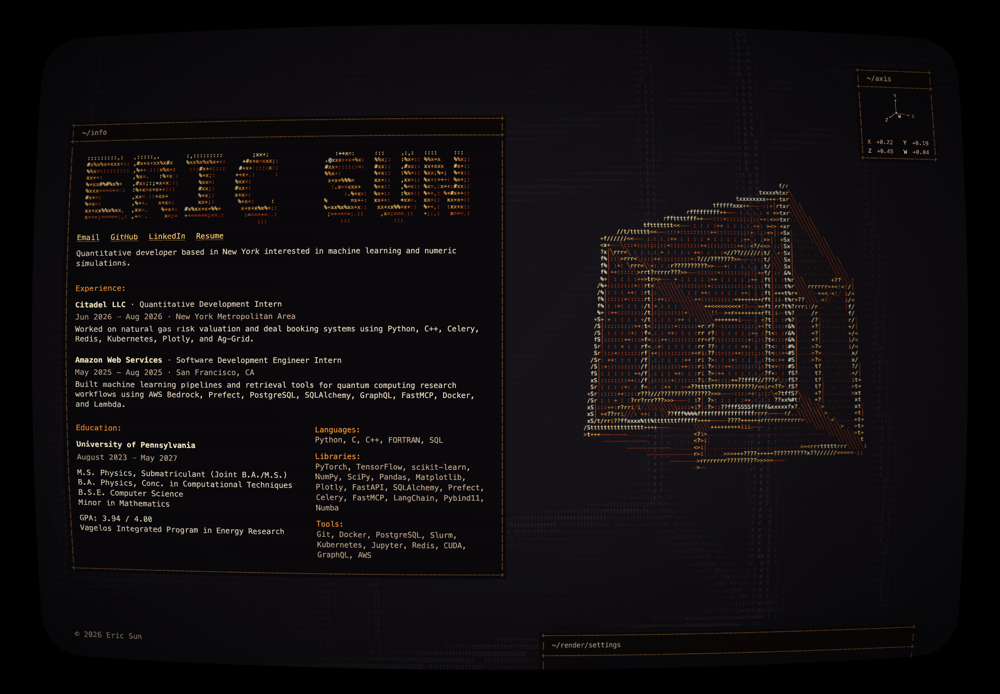

# ASCII tesseract portfolio

A dependency-free portfolio with an interactive ASCII 4D polytope and CRT effects.

[Live site](https://ericsun.net)



```sh
npm run dev       # http://localhost:4321
npm run check
npm test
npm run build     # dist/
```

The page lives in `public/tesseract/index.html`; scripts, styles, icons and vendor code are grouped under `assets/`. Notes live in `docs/`. The renderer uses Canvas 2D; CRT postprocessing uses WebGL, with native HTML sharing the screen's curvature. The effect toggle remembers its state. Reduced motion skips animations.

To update the vendored [CRT library](https://github.com/therealericsun/crt-effect), build the sibling `../crt-effect` repository and run `npm run sync:crt`. The website then serves independently.

The GitHub Pages workflow deploys `dist/` on pushes to `main`.
